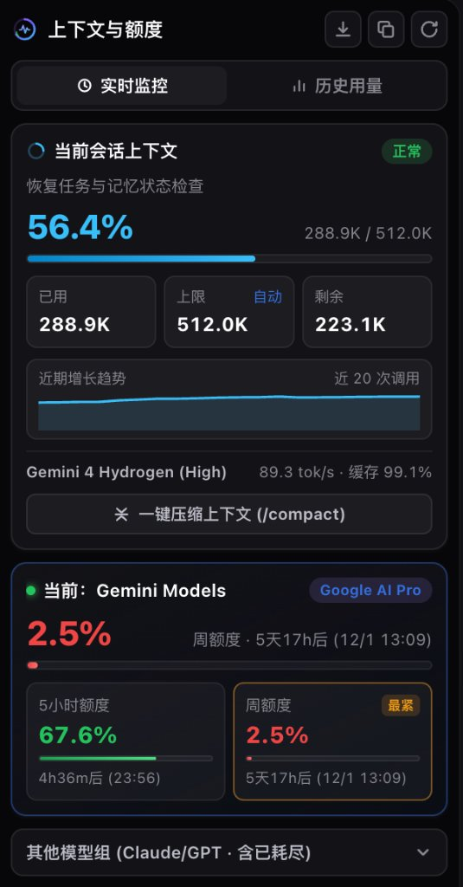
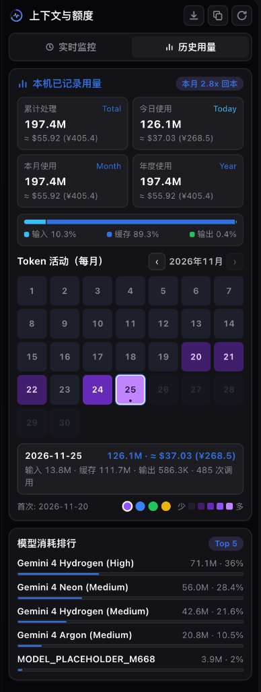

<div align="center">
  
  <h1>Antigravity 上下文与额度侧边栏插件</h1>
  <p>基于官方原生 Sidecar UI 机制的窄版中文监控面板 — 不修改 <code>app.asar</code>，客户端更新不失效</p>
</div>

---

## 🖼️ 界面预览

<div align="center">
  <table>
    <tr>
      <td align="center">
        
        <br />
        <sub><b>实时监控</b>：自动跟随窗口上下文 · 一键 <code>/compact</code> · 5 小时 / 周额度看板</sub>
      </td>
      <td align="center">
        
        <br />
        <sub><b>历史用量</b>：Token 累计统计 · 订阅回本倍数 · 月历热力图 & Top 5 模型排行</sub>
      </td>
    </tr>
  </table>
</div>

---

## ✨ 功能特性

- **原生零侵入**：遵循 Antigravity 官方 `~/.gemini/config/plugins/` 插件与 Sidecar 规范开发，**不改写 `app.asar`、不依赖调试端口、`ElectronAsarIntegrity` 完全安全**。
- **自动跟随客户端主题**：通过官方 `/preload.js` 桥接实时读取宿主主题变量（`--background` / `--card` / `--foreground` 等），浅色 / 深色模式无缝自动切换。
- **按模型自动识别上下文上限**：
  - 自动匹配当前对话所用模型默认上限（`Gemini 4 / Orchestrator` 512K、`Gemini 3.8 Flash` 256K、`Claude` 200K、`GPT-OSS` 128K）。
  - 点击「上限」卡片支持**按当前模型独立自定义上限**（`128K` / `200K` / `256K` / `512K` / `1M` 或恢复自动）。
- **直观的 5 小时 & 周滚动额度看板**：
  - 自动识别当前对话窗口使用的模型组（如 `Gemini Models` / `Claude and GPT models`）。
  - 采用与上下文卡一致的大字百分比 + 进度条，并列对比 **5 小时额度** 与 **周额度**，自动标记 **`最紧`** 额度与中文重置倒计时。
- **实时监控增强**：
  - **自动跟随当前对话窗口**：直接读取当前窗口的会话上下文，无需手动切换；支持近 20 次调用上下文增长曲线、生成速度（`tok/s`）与缓存命中率。
  - 提供**一键自动压缩上下文（`/compact`）**按钮（类似 Claude Code，占用 ≥ 75% 时高亮提醒），直接调用原生对话服务触发压缩。
  - 内置**插件内检查与一键更新**：右上角支持检查 GitHub 新版本并一键热更新覆盖安装（Sidecar 自动重启生效），同时保留剪贴板复制与快捷键 `R` 刷新。
- **历史用量与月历热力图**：
  - 统计本机累计 / 今日 / 本月 / 年度 Token 消耗与 API 参考折算，支持点击设置自定义订阅月费计算回本倍数。
  - 展示 **Top 5 模型消耗排行**、输入/缓存/输出比例构成条及 4 色系可切换月历热力图。

---

## 📥 怎么导入 / 安装

### 方式一：终端一键克隆安装（推荐）

```bash
git clone https://github.com/Katsurama/antigravity-context-quota-panel.git
cd antigravity-context-quota-panel
chmod +x install.sh update.sh uninstall.sh
./install.sh
```

> 开发者调试模式可使用 `./install.sh --link` 创建软链接，修改仓库代码后无需重复拷贝。

### 方式二：下载 Release 安装包手动导入

1. 前往 [GitHub Releases 最新版本](https://github.com/Katsurama/antigravity-context-quota-panel/releases/latest) 下载 `antigravity-context-quota-panel-v*.zip`（或点击右上角 **Download ZIP**）并解压。
2. 在本机创建插件目录 `~/.gemini/config/plugins/context-quota-panel/`。
3. 将解压得到的以下插件核心文件放入该目录中（保持目录结构不变）：
   ```text
   ~/.gemini/config/plugins/context-quota-panel/
   ├── plugin.json
   ├── assets/
   │   └── logo.svg
   └── sidecars/
       └── quota_meter/
           ├── sidecar.json
           ├── main.mjs
           └── index.html
   ```
4. 打开 Antigravity 左侧栏 **Customizations（插件管理）**，确认 **「上下文与额度」** 处于开启状态即可（无需重启客户端）。

---

## 🚀 怎么使用

1. **打开侧边栏面板**：
   - 在对话中点击助手提供的 `[上下文与额度]` 面板胶囊，或在右侧辅助栏（Aux Pane）切换到 **「上下文与额度」** 标签。
   - 拖动中间分隔线可自行调节侧边栏宽度（内容已按极窄布局适配）。
2. **「实时监控」页**：
   - 面板自动跟随当前对话窗口显示上下文占用；点击「上限」卡片可针对当前模型单独覆盖上下文上限。
   - 点击卡片底部的 **`一键压缩上下文 (/compact)`** 按钮，可直接触发当前会话的 `/compact` 上下文压缩，并在数秒后自动刷新状态。
   - 下方查看当前使用模型组的 **5 小时额度 / 周额度** 与 **最紧** 提醒；点击底部「其他模型组」可展开查看其余模型额度。
3. **「历史用量」页**：
   - 点击右上角 `本月 xx 回本` 胶囊可在行内填写或修改实际订阅月费（支持 USD / CNY）。
   - 点击月历方块查看当日明细，点击图例左侧圆点切换热力图色系。
4. **右上角工具栏与自动刷新**：
   - 从左到右依次为：**检查更新（`↓`）**、**复制当前状态摘要**、**立即刷新（`↻`，面板聚焦时按 `R` 键可快捷刷新）**。
   - 默认每 **30 秒** 自动刷新一次，侧边栏隐藏时自动暂停，节省内存与后台开销。

---

## 🔄 以后怎么更新

### 方式一：插件内一键更新（推荐）

点击侧边栏右上角的 **检查更新（↓）** 图标（或有新版本提示时点击顶部提示条的 **「立即更新」**），插件会直接从 GitHub 拉取最新版本文件并自动重启 Sidecar 生效，无需打开终端。

### 方式二：终端脚本更新

进入你当初克隆的仓库目录，执行一键更新脚本即可（会自动拉取最新代码、同步到插件目录并重启旧的 Sidecar 进程）：

```bash
cd antigravity-context-quota-panel
./update.sh
```

或者手动执行：

```bash
git pull --ff-only && ./install.sh
```

更新完成后，如果右侧面板正处于打开状态，点击面板右上角的 **`↻`** 刷新一下即可看到新版界面。

---

## 🗑️ 怎么卸载

运行卸载脚本（或直接删除 `~/.gemini/config/plugins/context-quota-panel` 目录）：

```bash
./uninstall.sh
```

---

## 📄 开源协议

[MIT License](LICENSE)
